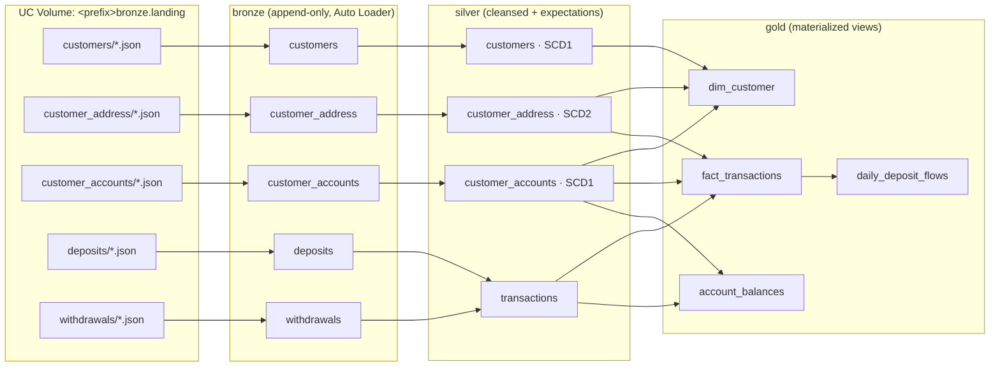

# Bank Deposits Medallion Lakehouse (Databricks Asset Bundle)

A Databricks project that loads bank deposit data through a **bronze → silver → gold** medallion
architecture using Lakeflow Declarative Pipelines (formerly DLT), Unity Catalog and Auto Loader.
It deploys as a **Databricks Asset Bundle** through a GitHub Actions CI/CD pipeline.

## Architecture



| Layer | Table | Notes |
|---|---|---|
| bronze | `customers`, `customer_address`, `customer_accounts`, `deposits`, `withdrawals` | Raw JSON as delivered + `_ingest_ts`, `_source_file`; unknown columns land in `_rescued_data` |
| silver | `customers` | SCD Type 1 via `create_auto_cdc_flow` keyed on `customer_id` |
| silver | `customer_address` | **SCD Type 2** keyed on `(customer_id, address_type)`, sequenced by `updated_at`. History columns `__START_AT` / `__END_AT`; current row has `__END_AT IS NULL`. Only real address changes open a new version |
| silver | `customer_accounts` | SCD Type 1 keyed on `account_id` |
| silver | `transactions` | Deposits + withdrawals unioned (two append flows), signed amounts, de-duplicated on `transaction_id`, bad rows dropped by expectations |
| gold | `dim_customer` | Customer + current HOME address + account counts |
| gold | `fact_transactions` | Transactions with account, plus the HOME city/state **as of the transaction time** (point-in-time join on the SCD2 history) |
| gold | `account_balances` | Balance, total deposits/withdrawals, last activity per account |
| gold | `daily_deposit_flows` | Daily inflow/outflow/net flow by account type and home state |

### Orchestration job (`bank_deposits_medallion_job`)

`setup_unity_catalog` (create schemas + landing volume) → `generate_sample_data` (only when
`generate_sample_data = "true"`) → `refresh_medallion_pipeline`. Scheduled daily at 06:00 UTC.

## Project layout

```
databricks.yml                 bundle definition, variables, dev/staging/prod targets
resources/
  bank_deposits_pipeline.yml   Lakeflow pipeline (serverless)
  bank_deposits_job.yml        orchestration job
src/
  pipelines/01_bronze.py       Auto Loader ingestion
  pipelines/02_silver.py       cleansing, SCD1/SCD2, transactions ledger
  pipelines/03_gold.py         materialized views
  bank_deposits/transforms.py  pure DataFrame logic (unit tested)
  bank_deposits/data_generator.py  synthetic source feeds
  jobs/                        job task entry points
tests/                         pytest (local PySpark)
.github/workflows/             ci.yml, cd.yml
```

## Local development

Prerequisites: Python 3.10+, Java 17 (for local PySpark tests), and the
[Databricks CLI](https://docs.databricks.com/dev-tools/cli/install.html) v0.250+.

```bash
python -m venv .venv && source .venv/bin/activate
pip install -r requirements-dev.txt
ruff check . && pytest

databricks auth login --host https://<your-dev-workspace>   # creates a CLI profile
databricks bundle validate                                   # dev is the default target
databricks bundle deploy
databricks bundle run bank_deposits_job                      # batch 1: initial load
databricks bundle run bank_deposits_job --params batch=2     # day 2: ~15% of customers move
```

In `dev`, schemas are prefixed with your user name (e.g. `main.jdoe_silver`) so every developer is
isolated, resources are named `[dev jdoe] ...`, and the schedule is paused.

See the SCD2 history after batch 2:

```sql
SELECT customer_id, city, state, __START_AT, __END_AT
FROM main.<you>_silver.customer_address
WHERE customer_id IN (
  SELECT customer_id FROM main.<you>_silver.customer_address
  GROUP BY customer_id, address_type HAVING count(*) > 1)
ORDER BY customer_id, __START_AT;
```

## CI/CD

| Workflow | Trigger | What it does |
|---|---|---|
| `ci.yml` | PR to `main` (and called by CD) | `ruff`, `pytest`, `databricks bundle validate -t staging` |
| `cd.yml` | push to `main`, manual | CI → deploy **staging** + run the job end to end as a smoke test → deploy **prod** (after approval) |

### One-time setup

1. **Workspaces**: set the real hosts in `databricks.yml` (`targets.staging.workspace.host`,
   `targets.prod.workspace.host`) and the catalog names (`bank_staging`, `bank_prod`). The
   catalogs must exist.
2. **Service principals**: create one per environment, give it workspace access, and grant it
   `USE CATALOG`, `CREATE SCHEMA` on the catalog. Create an OAuth secret for each.
3. **GitHub environments** (Settings → Environments): create `staging` and `prod`. In each, add the
   secrets `DATABRICKS_CLIENT_ID` and `DATABRICKS_CLIENT_SECRET` for that environment's service
   principal. On `prod`, add **Required reviewers** to get a manual approval gate.
4. Protect `main` (require PRs and the `CI` checks to pass).

Deployments run as the service principal, so the job and pipeline are owned by it and run as it.

### Going to production with real data

Point your upstream feeds at `/Volumes/<catalog>/bronze/landing/<entity>/` (JSON lines, one folder
per entity) and keep `generate_sample_data: "false"` (already the default in `prod`).
